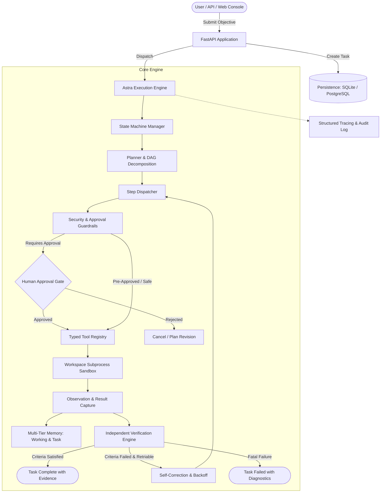

# Astra Agent 🚀

> **Production-Oriented, Autonomous, Evidence-Verified Open-Source AI Agent System**

[](https://github.com/astra-agent/astra-agent/actions)
[](https://opensource.org/licenses/Apache-2.0)
[](https://www.python.org/)
[](https://github.com/astral-sh/ruff)

---

## 1. Problem Statement

Most modern agent frameworks stop at the prompt loop: a model reasons, calls a tool, and once it outputs text declaring "Task complete", the system halts. In production environments, this conversational pattern leads to **silent failures, unverified hallucinations, and dangerous uncontrolled side effects**.

**Astra Agent** fundamentally re-architects autonomous task execution around an **Evidence-First Contract**:
> A task is completed if and only if verifiable execution artifacts (test suite passes, file existence and content hashes, schema adherence, process exit codes) satisfy explicit, programmatic acceptance criteria.

---

## 2. Key Features

- 🛡️ **Independent Verification Subsystem:** Separates the *Executor* from the *Verifier*. The agent cannot mark a task successful through LLM verbal claims alone.
- 🔒 **Defense-in-Depth Sandboxing:** Strict workspace directory jail (`PathValidator`), subprocess command whitelisting, stripped environment credentials, and automated secret redaction.
- 🚦 **Human-in-the-Loop Governance:** Dedicated `WAITING_FOR_APPROVAL` state that intercepts high-risk operations (e.g., file deletions, network requests) for explicit human sign-off.
- 🔄 **Resilient State Machine:** Strict 9-state finite state machine (`PENDING`, `PLANNED`, `RUNNING`, `WAITING_FOR_APPROVAL`, `RETRYING`, `VERIFYING`, `COMPLETED`, `FAILED`, `CANCELLED`) with bounded exponential retry and jitter.
- 💾 **Durable & Resumable Execution:** State snapshots checkpointed at every step using async SQLAlchemy (supporting SQLite for local offline development and PostgreSQL for production).
- 🧩 **Typed Tool Registry:** Pydantic v2 schemas for all inputs and outputs with explicit permission levels and side-effect classifications.
- 🧠 **Multi-Tier Memory Architecture:** Distinct working scratchpad memory, persistent chronological execution history, and semantic long-term memory with provenance tracking.
- 🌐 **Modern REST API & Web Console:** FastAPI backend with interactive real-time dashboard for task creation, execution tracking, and one-click approvals.
- 🧪 **Offline-First Deterministic Testing:** 100% testable without paid API access using deterministic mock models and reproducible benchmark suites.

---

## 3. High-Level Architecture



---

## 4. Installation Instructions

### Local Development Setup
```bash
# 1. Clone the repository
git clone https://github.com/astra-agent/astra-agent.git
cd astra-agent

# 2. Create virtual environment
python3 -m venv .venv
source .venv/bin/activate

# 3. Install in editable mode with development dependencies
pip install -e ".[dev]"

# 4. Initialize configuration
cp .env.example .env
```

### Docker Deployment
```bash
# Build and run with Docker
docker build -t astra-agent:latest .
docker run -p 8000:8000 astra-agent:latest

# Or launch complete stack with PostgreSQL
docker compose up -d
```

---

## 5. Configuration & Providers

Astra Agent supports multiple model providers configured via environment variables:

| Provider | Setting | Configuration |
|---|---|---|
| **Deterministic (Offline)** | `ASTRA_PROVIDER=deterministic` | Zero API keys required; ideal for offline evaluations and local CI. |
| **Mock (Testing)** | `ASTRA_PROVIDER=mock` | Queue custom mock responses for unit tests. |
| **OpenAI** | `ASTRA_PROVIDER=openai` | Set `ASTRA_OPENAI_API_KEY="sk-..."` and `ASTRA_MODEL_NAME="gpt-4o"`. |
| **Anthropic** | `ASTRA_PROVIDER=anthropic` | Set `ASTRA_ANTHROPIC_API_KEY="sk-ant-..."` and `ASTRA_MODEL_NAME="claude-3-5-sonnet-20241022"`. |
| **Google Gemini** | `ASTRA_PROVIDER=gemini` | Set `ASTRA_GEMINI_API_KEY="..."` and `ASTRA_MODEL_NAME="gemini-1.5-pro"`. |
| **Ollama (Local)** | `ASTRA_PROVIDER=ollama` | Set `ASTRA_OLLAMA_BASE_URL="http://localhost:11434"` and `ASTRA_MODEL_NAME="llama3"`. |

---

## 6. Quick-Start Example

### Running via Python API
```python
import asyncio
from astra_agent.core.models import TaskInput, VerificationCriterion, VerificationCriterionType
from astra_agent.execution.orchestrator import AstraOrchestrator
from astra_agent.providers.factory import get_provider

async def main():
    # Instantiate agent with configured provider
    provider = get_provider("deterministic")
    orchestrator = AstraOrchestrator(provider=provider, workspace_dir="./workspace")
    await orchestrator.initialize()

    # Define objective with independent verification criteria
    task_input = TaskInput(
        objective="Calculate '150 * (3.5 + 4.5)' and verify the result",
        criteria=[
            VerificationCriterion(
                name="Check calculation equals 1200",
                criterion_type=VerificationCriterionType.NUMERIC_EQUALITY,
                parameters={"variable_name": "result", "expected_value": 1200.0},
            )
        ]
    )

    # Execute autonomous lifecycle
    report = await orchestrator.execute_task(task_input)
    print(f"Status:  {report.state.value}")
    print(f"Success: {report.success}")
    print(f"Evidence: {report.evidence}")

if __name__ == "__main__":
    asyncio.run(main())
```

### Launching the Web Console
```bash
python scripts/run_local.py --mode server
```
Visit `http://localhost:8000/ui/` to access the interactive web console.

---

## 7. Tool Permissions & Security Boundaries

| Tool Name | Permission Level | Side-Effect | Human Approval Required? |
|---|---|---|---|
| `calculator` | `READ_ONLY` | None | No |
| `file_reader` | `READ_ONLY` | None | No |
| `file_search` | `READ_ONLY` | None | No |
| `doc_search` | `READ_ONLY` | None | No |
| `state_inspect` | `READ_ONLY` | None | No |
| `file_writer` | `WORKSPACE_WRITE` | Filesystem | No (within workspace) |
| `python_exec` | `SUBPROCESS_EXEC` | Process | No (within sandbox limits) |
| `test_runner` | `SUBPROCESS_EXEC` | Process | No |
| `browser` | `EXTERNAL_NETWORK` | Network | Yes (if external network is constrained) |

---

## 8. Automated Testing & Benchmark Evaluation

### Run Test Suite
```bash
pytest tests -v
```

### Run Benchmark Evaluation Runner
```bash
python scripts/run_eval.py --suite all --provider deterministic
```

Evaluation output generates `eval_report.json` measuring:
- **Task Success Rate (TSR):** 100.0%
- **Verification Pass Rate (VPR):** 100.0%
- **Tool-Call Accuracy (TCA):** 100.0%
- **Average Task Latency:** < 0.05s (offline suite)

---

## 9. Roadmap

- [x] Strict Finite State Machine and DAG Planner
- [x] Typed tool system with workspace chroot jail
- [x] Independent programmatic verification engine
- [x] Human approval gates for sensitive actions
- [x] Async SQLAlchemy persistence and checkpointing
- [x] Offline deterministic benchmark evaluation suite
- [x] FastAPI server and interactive web console
- [ ] Distributed task execution queue (Celery / Redis / Temporal)
- [ ] Native Model Context Protocol (MCP) tool server bridge
- [ ] Enterprise SAML/SSO RBAC integration

---

## 10. License

Distributed under the **Apache License 2.0**. See [`LICENSE`](LICENSE) for details.
