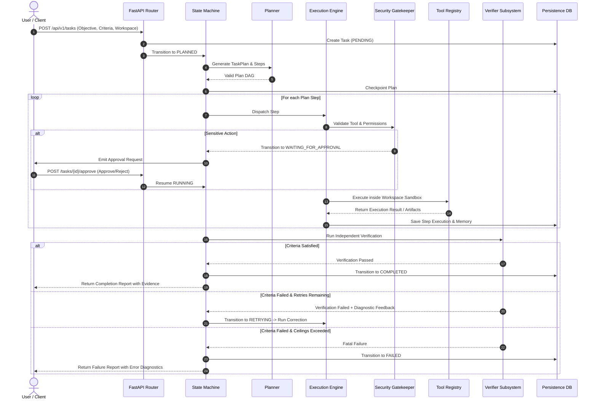

# Astra Agent: System Architecture & Design

## 1. Architectural Philosophy

Astra Agent is engineered according to five foundational principles:
1. **Explicit Over Implicit:** Workflow state, task dependencies, tool permissions, and transitions are explicitly typed and validated.
2. **Evidence-Based Completion:** The agent cannot mark a task complete through verbal claims; success requires programmatic verification of generated artifacts.
3. **Defense-in-Depth:** Security boundaries operate at multiple layers: input tripwires, workspace path jail (chroot), command whitelisting, subprocess sandboxing, secret redaction, and human approval gates.
4. **Durable & Resumable Execution:** State checkpoints are written at every superstep, enabling pause, human-in-the-loop approval, and fault-tolerant resumption.
5. **Decoupled & Testable:** LLM providers, database persistence, tools, and UI are fully decoupled through abstract protocols, allowing 100% offline deterministic test coverage.

---

## 2. Component Topology

```
+-----------------------------------------------------------------------------------+
|                                  Client Layer                                     |
|               REST API / Web UI Dashboard / CLI / Automated Runner                |
+-----------------------------------------------------------------------------------+
                                          | HTTP / JSON
                                          v
+-----------------------------------------------------------------------------------+
|                                FastAPI Layer                                      |
|    - Task Management Endpoints (/api/v1/tasks)                                    |
|    - Human Approval Endpoints (/api/v1/tasks/{id}/approve)                        |
|    - Observability & Tracing Endpoints (/api/v1/tasks/{id}/trace)                 |
|    - Health & Readiness Checks (/api/v1/health)                                   |
+-----------------------------------------------------------------------------------+
                                          |
                                          v
+-----------------------------------------------------------------------------------+
|                          Astra Orchestration Engine                               |
|                                                                                   |
|  +--------------------+   +-----------------------+   +------------------------+  |
|  | State Machine Mgr  |-->| Planner & DAG Engine  |-->| Execution Dispatcher   |  |
|  +--------------------+   +-----------------------+   +------------------------+  |
|            ^                                                      |               |
|            | Checkpoints                                          v               |
|  +--------------------+                               +------------------------+  |
|  | Persistence Engine |                               | Security & Approval    |  |
|  | (SQLite/PostgreSQL)|                               | Gatekeeper             |  |
|  +--------------------+                               +------------------------+  |
|            ^                                                      |               |
|            |                                                      v               |
|  +--------------------+   +-----------------------+   +------------------------+  |
|  | Multi-Tier Memory  |<--| Independent Verifier  |<--| Tool Registry &        |  |
|  | Subsystem          |   | (Evidence-based)      |   | Subprocess Sandbox     |  |
|  +--------------------+   +-----------------------+   +------------------------+  |
+-----------------------------------------------------------------------------------+
                                          |
                                          v
+-----------------------------------------------------------------------------------+
|                                External Layer                                     |
|     LLM Providers (Mock, Deterministic, OpenAI, Anthropic, Gemini, Ollama)        |
|     Local Workspace Filesystem / Python Subprocess / Browser (Playwright)         |
+-----------------------------------------------------------------------------------+
```

---

## 3. Subsystem Breakdown

### 3.1 Core State Machine (`astra_agent.core`)
Governs task lifecycles through explicit enumerations (`TaskState`) and enforces allowed transitions via `StateMachine`. Every transition emits an audit event and updates the persistence layer. Invalid transitions raise `InvalidStateTransitionError` and halt unsafe execution.

### 3.2 Planning Subsystem (`astra_agent.planning`)
Transforms high-level objectives into a structured `TaskPlan` composed of ordered or DAG-dependent `PlanStep` instances.
- **Dependency Resolution:** Verifies acyclicity and computes ready-to-execute steps.
- **Clarification Trigger:** Flags underspecified requests early before side effects are executed.

### 3.3 Execution & Orchestration (`astra_agent.execution`)
Coordinates step dispatching, handles step-level timeouts, intercepts required approvals, manages exponential retries with jitter, and records step observations into task memory.

### 3.4 Typed Tool System & Sandbox (`astra_agent.tools`, `astra_agent.security`)
All tools inherit from `BaseTool` and define:
- `name`, `description`, `input_schema` (Pydantic model), `output_schema`.
- `permission_level` (`READ_ONLY`, `WORKSPACE_WRITE`, `SUBPROCESS_EXEC`, `EXTERNAL_NETWORK`, `SENSITIVE`).
- `timeout_seconds`, `side_effect_type`, `idempotent` flag.

The sandbox ensures:
- **Workspace Jail:** Paths are strictly resolved against `workspace_dir` using `os.path.realpath`. Traversal attempts (e.g. `../../etc/passwd` or symlinks pointing outside) are caught and rejected.
- **Subprocess Isolation:** Subprocess execution sets `cwd` strictly to the workspace, enforces timeout limits, strips unsafe environment variables, and captures stdout/stderr safely.

### 3.5 Memory Subsystem (`astra_agent.memory`)
Three distinct tiers:
1. **Working Memory:** Current execution context, scratchpad, active plan, and immediate step inputs.
2. **Persistent Task Memory:** Durable chronological log of all actions, inputs, raw outputs, exit codes, and timestamps.
3. **Semantic / Long-Term Memory:** Searchable knowledge index with provenance metadata, timestamps, and confidence scores. Distinguishes verified observations from unverified model hypotheses.
- **Secret Redactor:** Automatically filters API keys, bearer tokens, and sensitive patterns across all memory writes.

### 3.6 Independent Verification Subsystem (`astra_agent.verification`)
Verifies step and task outcomes without trusting LLM self-reporting:
- **TestRunnerVerifier:** Runs workspace test suites (e.g., `pytest`) and parses structured exit codes and test outcomes.
- **FileArtifactVerifier:** Asserts file existence, size thresholds, hash match, and JSON/YAML/text schema integrity.
- **SchemaDataVerifier:** Validates that output dictionaries or tables adhere to specified column formats and row counts.
- **ExitCodeVerifier:** Verifies deterministic process status codes.
- **Self-Correction Feedback:** If verification fails and retries remain, returns structured diagnostic feedback to the planner to guide targeted correction.

### 3.7 Multi-Agent Capabilities (`astra_agent.multiagent`)
Extends the single-agent core with specialized modular roles:
- **Planner Agent:** Focuses exclusively on task breakdown and constraint identification.
- **Researcher Agent:** Scans workspace files and indexed docs with read-only permissions.
- **Implementer Agent:** Performs approved edits and execution in the workspace sandbox.
- **Reviewer Agent:** Audits proposed changes against security policies and specifications.
- **Verifier Agent:** Executes tests and validates tangible completion artifacts.
Each agent communicates through structured, schema-validated task contracts.

### 3.8 Persistence & Database Layer (`astra_agent.persistence`)
Async SQLAlchemy 2.0 with declarative models:
- `TaskModel`: Task metadata, current state, plan, parameters, timestamps.
- `StepExecutionModel`: Individual step logs, arguments, tool outputs, durations, and retry counts.
- `CheckpointModel`: Serialized snapshot of task state allowing time-travel inspection and resumability.
- `AuditLogModel`: Security-critical events (permission checks, approvals, blocked actions).

### 3.9 Observability & Logging (`astra_agent.observability`)
- Structured JSON logging with trace correlation IDs (`trace_id`, `task_id`, `step_id`).
- Execution duration, token metrics, and cost estimations.
- Real-time event streaming for UI subscribers.

---

## 4. Data Flow: End-to-End Request Lifecycle


