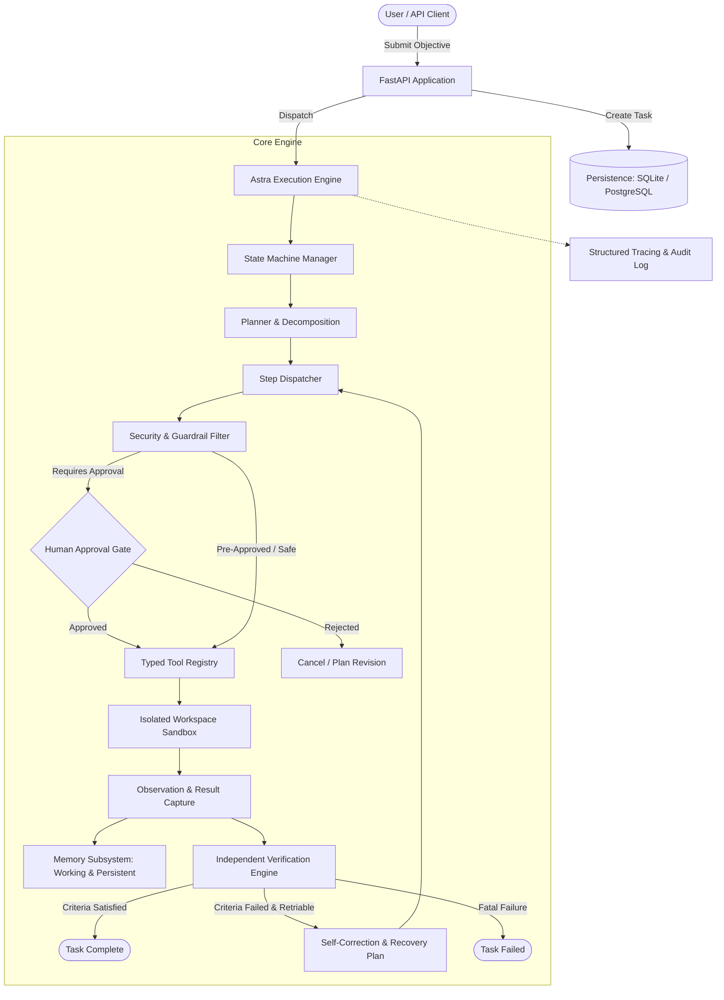

# Phase 1: Open-Source AI Agent Architecture Research

## Executive Summary

Autonomous agent systems represent a paradigm shift from single-turn language model completions to goal-directed, multi-step execution environments. To build **Astra Agent** as a production-grade, autonomous, secure, and extensible system, we conducted an in-depth architectural inspection of eight prominent open-source agent projects:

1. **OpenHands** (`All-Hands-AI/OpenHands`)
2. **LangGraph** (`langchain-ai/langgraph`)
3. **OpenAI Agents SDK** (`openai/openai-agents-python`)
4. **CrewAI** (`crewAIInc/crewAI`)
5. **OpenClaw** (`openclaw/openclaw`)
6. **Browser Use** (`browser-use/browser-use`)
7. **Hugging Face smolagents** (`huggingface/smolagents`)
8. **Pydantic AI** (`pydantic/pydantic-ai`)

This document synthesizes our architectural findings across twelve systematic dimensions, isolates proven patterns versus anti-patterns, defines Astra Agent's differentiation strategy, and justifies our core architectural decisions.

---

## 1. Deep Dive: Comparative Analysis of the 8 Projects

### 1.1 OpenHands (formerly OpenDevin)
- **Repository:** `All-Hands-AI/OpenHands` (License: MIT)
- **Primary Use Cases:** Full-stack software engineering, autonomous codebase modifications, terminal command execution, interactive developer pair-programming.
- **Agent Execution Loop:** Event-driven pub/sub architecture. Every interaction is modeled as an immutable `Action` (e.g., `CmdRunAction`, `FileWriteAction`, `BrowseURLAction`) or `Observation` (e.g., `CmdOutputObservation`, `FileReadObservation`). An EventStream acts as the single source of truth.
- **Planning & Task Decomposition:** Dynamic decomposition through structured LLM thoughts and delegated sub-agents (e.g., Planner agent, Code modifier agent).
- **Tool Integration:** Tools are executed as typed actions inside a runtime container.
- **Memory & Persistence:** Event log persistence per session; state can be replayed or resumed from database storage.
- **Error Recovery:** Model receives stdout/stderr observations and adjusts command formulations in subsequent iterations.
- **Human Approval:** Security policies and confirmation prompts for risky actions (e.g., system commands, destructive modifications).
- **Sandboxing & Security:** Strong Docker container isolation (`docker.all-hands.dev/all-hands-ai/runtime`) with dropped capabilities (`cap-drop ALL`, `no-new-privileges`) and isolated network configurations.
- **Observability:** Event stream inspection, WebSocket streaming to frontend, OpenTelemetry trace instrumentation.
- **Testing & Evaluation:** Extensive integration tests and benchmark suites evaluated against SWE-bench.
- **Extensibility:** Microservice SDK (`openhands-sdk`) separating agent logic, runtime, and UI.
- **Operational Complexity:** High (requires Docker daemon, runtime images, client-server event bus, persistent volume mounts).

### 1.2 LangGraph
- **Repository:** `langchain-ai/langgraph` (License: MIT)
- **Primary Use Cases:** Stateful, cyclic, multi-actor orchestration for complex conversational and task-oriented workflows.
- **Agent Execution Loop:** Pregel-style message-passing state machine. Workflows are defined as directed graphs where `Nodes` perform work and `Edges` determine routing (conditional or static).
- **Planning & Task Decomposition:** Graph topologies define explicit stages (e.g., plan -> critique -> execute -> verify).
- **Tool Integration:** Tools are encapsulated in dedicated tool nodes triggered by LLM tool-call output channels.
- **Memory & Persistence:** First-class durable execution via thread checkpoints. State is snapshotted at every superstep using pluggable checkpointers (`MemorySaver`, `SqliteSaver`, `PostgresSaver`).
- **Error Recovery:** Conditional fallback edges and state rewind capabilities.
- **Human Approval:** Native `interrupt()` and breakpoint mechanisms allowing out-of-band state inspection, human modification, and resumption.
- **Sandboxing & Security:** Framework-level neutral; sandboxing must be implemented downstream by developers.
- **Observability:** Deep integration with LangSmith for span-level execution trees, latency, and token monitoring.
- **Testing & Evaluation:** Unit testing of individual nodes and deterministic graph evaluation.
- **Extensibility:** Highly flexible via custom state schemas (`TypedDict` / Pydantic) and channel definitions.
- **Operational Complexity:** Moderate to High when running persistent databases and distributed workers.

### 1.3 OpenAI Agents SDK
- **Repository:** `openai/openai-agents-python` (License: MIT)
- **Primary Use Cases:** Lightweight, code-first multi-agent orchestration with seamless transitions and guardrails.
- **Agent Execution Loop:** Minimalist `Runner.run()` loop. The model outputs function calls, the runner executes them locally, updates conversation history, and invokes the model again until a final message is generated.
- **Planning & Task Decomposition:** Orchestrated via agent handoffs—agents delegate sub-tasks to other specialized agents treated as callable tools.
- **Tool Integration:** Native Python function wrapping with type annotations and Pydantic validation.
- **Memory & Persistence:** In-memory message histories passed through session contexts; requires external orchestrators (like Temporal) for long-term durable execution.
- **Error Recovery:** Basic exception bubbling to runner; model prompted with error message if tool execution fails.
- **Human Approval:** Implemented via custom tool hooks or tripwires before action execution.
- **Sandboxing & Security:** Pre-execution and post-execution guardrails (InputGuardrail, OutputGuardrail) using classifier models or rule-based tripwires.
- **Observability:** Built-in tracing primitives capturing tool calls, handoffs, and latencies.
- **Testing & Evaluation:** Fast offline unit testing using mock client wrappers.
- **Extensibility:** Clean, idiomatic Python patterns with minimal framework overhead.
- **Operational Complexity:** Low (in-process library).

### 1.4 CrewAI
- **Repository:** `crewAIInc/crewAI` (License: MIT)
- **Primary Use Cases:** Multi-agent role-playing workflows for business process automation, research, and collaborative document synthesis.
- **Agent Execution Loop:** Iterative ReAct loop with configurable `max_iter`, sequential or hierarchical process execution managed by Crew and Flow abstractions.
- **Planning & Task Decomposition:** Coordinating manager agents break down high-level objectives into discrete task descriptions with explicit output schemas.
- **Tool Integration:** Subclassing `BaseTool` or `@tool` decorator, native MCP (Model Context Protocol) support.
- **Memory & Persistence:** Unified `Memory` class integrating short-term, long-term, and entity memory with vector-based recall and adaptive importance scoring.
- **Error Recovery:** Self-correction loops re-prompting the agent with tool execution errors.
- **Human Approval:** Built-in `human_input=True` flag pausing task execution for console or API input.
- **Sandboxing & Security:** Integration with external cloud execution sandboxes (E2B, Daytona).
- **Observability:** Native logging and telemetry integrations (AgentOps, OpenTelemetry).
- **Testing & Evaluation:** Crew evaluation frameworks measuring task completion and agent collaboration.
- **Extensibility:** High for agent persona composition; moderate for low-level execution loop customization.
- **Operational Complexity:** Moderate.

### 1.5 OpenClaw
- **Repository:** `openclaw/openclaw` (License: MIT)
- **Primary Use Cases:** Local-first personal AI assistant, multi-channel communication gateway (WhatsApp, Telegram, Slack, Discord), desktop automation.
- **Agent Execution Loop:** Gateway-centered event routing. The gateway receives inbound chat events, passes them to the agent runtime, coordinates tool actions, and streams responses back to chat channels.
- **Planning & Task Decomposition:** Conversational multi-turn task breakdown.
- **Tool Integration:** Local OS tools, shell execution, calendar, messaging integrations.
- **Memory & Persistence:** Local SQLite database storing user sessions, credentials, and conversation logs.
- **Error Recovery:** Retry policies on API timeouts and channel reconnects.
- **Human Approval:** Interactive confirmation via chat message buttons or interactive CLI prompts.
- **Sandboxing & Security:** Local-first architecture; requires strict host permission controls since it interacts directly with personal apps and files.
- **Observability:** Centralized logging in local gateway, WebSocket event inspection.
- **Testing & Evaluation:** Monorepo package unit tests and channel mock integration tests.
- **Extensibility:** Monorepo package structure (`packages/core`, `packages/gateway`, `packages/agent`).
- **Operational Complexity:** Low to Moderate (runs locally on user machine or personal VPS).

### 1.6 Browser Use
- **Repository:** `browser-use/browser-use` (License: MIT)
- **Primary Use Cases:** Autonomous web browser navigation, web scraping, form filling, web application interaction.
- **Agent Execution Loop:** Perception-Action ReAct loop. In each step, the agent observes the browser viewport, receives a simplified interactive DOM state + screenshot, reasons over next steps, and emits Playwright actions.
- **Planning & Task Decomposition:** Step-by-step goal pursuit with history tracking and failure detection.
- **Tool Integration:** Browser controller exposing atomic Playwright actions: `click_element`, `input_text`, `scroll`, `navigate`, `extract_content`.
- **Memory & Persistence:** Tab and session state retained in browser context; action history tracked per task run.
- **Error Recovery:** Automatically detects unclickable elements, DOM mutations, and navigation timeouts, providing corrective observations to the model.
- **Human Approval:** Pause for user interaction (e.g., manual CAPTCHA solving or 2FA entry).
- **Sandboxing & Security:** Browser process sandboxing via Playwright Chromium flags; must prevent malicious JavaScript and prompt injection from visited web pages.
- **Observability:** Visual step replay, animated GIF/video recording, trace logs.
- **Testing & Evaluation:** Headless browser integration tests against mocked web pages.
- **Extensibility:** Custom actions can be registered onto the Controller.
- **Operational Complexity:** Moderate (requires browser binaries, display servers or headless drivers).

### 1.7 Hugging Face smolagents
- **Repository:** `huggingface/smolagents` (License: Apache 2.0)
- **Primary Use Cases:** Lightweight autonomous agents, programmatic tool execution, multi-modal reasoning.
- **Agent Execution Loop:** ReAct multi-step loop implemented via two main paradigms: `CodeAgent` (generates executable Python code snippets) and `ToolCallingAgent` (generates structured JSON tool calls).
- **Planning & Task Decomposition:** Rule-based planning steps interleaved with execution actions.
- **Tool Integration:** Dynamic Python function decorators (`@tool`), LangChain tool wrappers, and MCP servers.
- **Memory & Persistence:** In-memory execution step list (`ActionStep`) holding LLM thoughts, code snippets, and execution outputs.
- **Error Recovery:** Python syntax errors and runtime tracebacks are captured and fed directly back into the model prompt for iterative debugging.
- **Human Approval:** Can be hooked into step execution callbacks.
- **Sandboxing & Security:** AST-parsed restricted Python execution engine or containerized execution (E2B, Docker, Modal) to mitigate arbitrary code risks.
- **Observability:** Clean terminal logs, rich tracebacks, OpenTelemetry exports.
- **Testing & Evaluation:** Standard pytest suite and benchmark evaluations.
- **Extensibility:** Very high due to minimal (<1,000 LOC) codebase.
- **Operational Complexity:** Very Low.

### 1.8 Pydantic AI
- **Repository:** `pydantic/pydantic-ai` (License: MIT)
- **Primary Use Cases:** Production-grade, type-safe LLM engineering, structured data extraction, deterministic backend agent integrations.
- **Agent Execution Loop:** Clean functional loop where an `Agent` instance runs against an LLM, invokes registered tools, validates outputs against Pydantic models, and returns strongly-typed results.
- **Planning & Task Decomposition:** User-defined or model-prompted step logic; encourages modular composable agents.
- **Tool Integration:** Elegant dependency injection via `RunContext[DepsT]`. Tools are typed Python functions receiving injected services (database connections, HTTP clients).
- **Memory & Persistence:** History messages serialized via standard Pydantic models; easily persisted in PostgreSQL or Redis.
- **Error Recovery:** Automatic model re-prompting when tool inputs or output schemas fail validation, complete with detailed validation errors.
- **Human Approval:** Programmatic approval workflows supported via external state pauses.
- **Sandboxing & Security:** Strong input/output type safety; developers enforce execution boundaries in injected dependencies.
- **Observability:** Built-in OpenTelemetry instrumentation and native integration with Pydantic Logfire.
- **Testing & Evaluation:** Industry-leading testability: `TestModel` and `FunctionModel` enable deterministic offline testing without network or API costs.
- **Extensibility:** Exceptional, leveraging native Python typing, generics, and Pydantic validation.
- **Operational Complexity:** Very Low.

---

## 2. Key Architectural Takeaways

| Dimension | Best-in-Class Pattern | Identified Pitfall / Anti-Pattern to Avoid | Selected Project Inspiration |
|---|---|---|---|
| **Execution Loop** | Explicit Finite State Machine (FSM) with strict transitions and immutable event log | Unbounded `while True` loops without step limits, timeouts, or state checkpointing | LangGraph & OpenHands |
| **Type Safety & Contracts** | Strongly-typed schemas for inputs, outputs, tool arguments, and task states | Free-form unstructured JSON strings or loose dicts passed between stages | Pydantic AI |
| **Tool Execution & DI** | Type-annotated tools with injected context, explicit permissions, and side-effect markers | Unrestricted global access, dynamic eval without sanitization | Pydantic AI & smolagents |
| **Sandboxing & Isolation** | Isolated subprocess / container execution with workspace path sandboxing, strict timeouts, and memory limits | Executing arbitrary shell scripts directly on the host system | OpenHands |
| **Persistence & Checkpoints** | Serializable task snapshots at each step enabling pause, resume, and audit | In-memory only state that is lost on crash or container restart | LangGraph |
| **Verification Subsystem** | Independent verification based on concrete execution artifacts (exit codes, test passes, file existence) | Trusting the agent's self-generated claim that it succeeded | Core Requirement |
| **Human in the Loop** | Dedicated `WAITING_FOR_APPROVAL` state for sensitive actions (writes outside workspace, deletions, billable operations) | Asking human confirmation for trivial read operations or never asking at all | OpenHands & LangGraph |
| **Error Recovery** | Classified errors (transient vs permanent) with exponential backoff, jitter, and bounded retry policies | Blind retries on non-idempotent operations causing duplicate side effects | Production SRE Standard |
| **Observability** | Structured logging, span traces, execution history timeline, and token/cost tracking | Silent console print statements mixed with LLM outputs | Pydantic AI & OpenHands |

---

## 3. What to Adopt vs. What to Avoid

### Architectural Ideas to Adopt:
1. **Explicit State Machine:** Define strict states (`PENDING`, `PLANNED`, `RUNNING`, `WAITING_FOR_APPROVAL`, `RETRYING`, `VERIFYING`, `COMPLETED`, `FAILED`, `CANCELLED`) with validated legal transitions.
2. **Typed Dependency Injection:** Adopt Pydantic-based schemas and injected runtime contexts for all tools and lifecycle hooks.
3. **Multi-Tier Memory Architecture:** Distinct working memory (current prompt context), persistent task memory (execution checkpoints and tool observations), and semantic memory (searchable knowledge).
4. **Independent Evidence-Based Verification:** Implement a dedicated verification phase that inspects real-world artifacts (test outputs, generated file contents, exit codes) before marking a task complete.
5. **Security Sandbox & Path Containment:** Strict workspace chroot enforcement, blocking directory traversal (`../`), path canonicalization, command whitelisting, and secret redaction.
6. **Deterministic Offline Testability:** Mock LLM providers that return predetermined tool-calling sequences for robust CI/CD without API keys.

### Approaches to Avoid:
1. **Monolithic Framework Lock-In:** Do not force users to adopt an unwieldy DSL or massive framework overhead for simple workflows.
2. **Unsandboxed Host Command Execution:** Never execute arbitrary model-generated shell commands directly on the host system without restriction.
3. **Self-Delusional Verification:** Never allow an LLM's prose ("I have successfully fixed the bug") to serve as completion proof without verified execution evidence.
4. **Unbounded Autonomous Loops:** Prevent runaway execution costs by enforcing hard step bounds, wall-clock timeouts, and retry ceilings.
5. **Over-Engineered Multi-Agent Swarms on Day 1:** Avoid spawning 5 uncoordinated agents when a single, well-instrumented agent with verified steps achieves higher reliability at 1/5th the cost.

---

## 4. Astra Agent Differentiation Strategy

Astra Agent is engineered specifically for **production reliability, verifiable autonomy, and defensible security**:

1. **Truth via Independent Verification:** Astra Agent separates the *Executor* from the *Verifier*. Completion requires passing deterministic verification rules (unit tests, schema checks, file assertions) rather than LLM self-congratulation.
2. **Security-First Architecture:** Built-in workspace filesystem isolation, command safety policies, sensitive action approval gates, secret masking, and prompt injection tripwires.
3. **Resilient Durable Execution:** Checkpointed state at every transition, allowing tasks to be paused, reviewed, resumed, or safely rolled back.
4. **Developer-Grade Cleanliness:** Python 3.11+ using standard FastAPI, Pydantic v2, SQLAlchemy, and pytest. Zero esoteric DSLs, zero hidden state.
5. **Single-Agent Excellence with Optional Specialization:** Rock-solid single-agent execution foundation that seamlessly scales to role-specialized collaboration (Planner, Researcher, Implementer, Reviewer, Verifier) when task complexity justifies it.

---

## 5. Proposed High-Level Architecture

---

## 6. Technology Choices & Trade-Offs

| Component | Choice | Evaluated Alternatives | Rationale & Trade-offs |
|---|---|---|---|
| **Language** | Python 3.11+ | TypeScript, Go | Ecosystem dominance for AI tooling, native async support, rich data validation libraries. |
| **API Backend** | FastAPI | Flask, Django, Litestar | Fast, async native, auto-generates OpenAPI docs, seamless Pydantic v2 integration. |
| **Data Validation** | Pydantic v2 | Marshmallow, attrs | High performance (Rust core), strict typing, ubiquitous in modern Python AI tooling. |
| **Database ORM** | SQLAlchemy 2.0 (Async) + Alembic | Raw SQL, Tortoise ORM | Industry standard, robust migration path, supports SQLite for local testing and PostgreSQL for production. |
| **State Engine** | Native FSM Engine | LangGraph, Temporal | Avoids heavyweight external dependencies while providing 100% deterministic state transitions and checkpointing. |
| **Sandboxing** | Subprocess Sandbox with Path Chroot + Resource Limits | Full Docker daemon, E2B | Subprocess isolation with strict directory boundaries and resource caps runs everywhere out-of-the-box without Docker dependency; Docker supported as optional deployment container. |
| **Testing** | pytest + pytest-asyncio | unittest | Clean fixtures, parameterized tests, rich plugin ecosystem. |
| **Browser Control** | Playwright (Optional Tool) | Selenium, Puppeteer | Modern async event-driven architecture, robust headless execution. |
| **LLM Interface** | Clean Abstract Provider (Mock, Deterministic, OpenAI, Anthropic, Gemini, Ollama) | Direct vendor SDKs, LiteLLM | Decoupled abstraction ensures total offline testability with deterministic outputs and zero credential leaks. |

---

## 7. License and Attribution Compliance

Astra Agent is distributed under the **Apache License 2.0**. It is an independently authored clean-room implementation inspired by the architectural principles of the open-source community. All inspirations from MIT and Apache 2.0 projects are respectfully documented, and no third-party copyrighted code is copied into this codebase.
